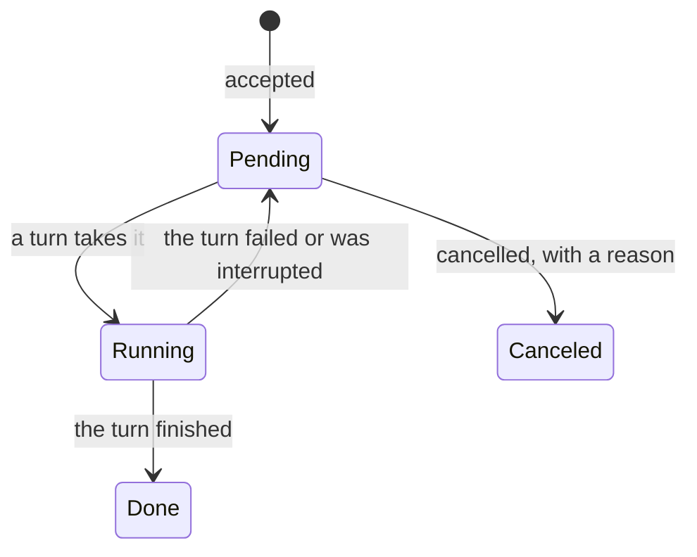

# Wake

A durable request for an agent's attention: the [agent](AGENT.md), the [conversation](CONVERSATION.md), where it came from, a key that identifies it, an optional note, and an optional time before which it must not run.

A wake carries a label and a note, never a payload. What the source wants the agent to look at is shown by the source's own tools.

The idea the rest follows from: a wake is a promise. It is written down before it is acknowledged, and it stays owed until a turn that was shown it has finished.

## Invariants

- **A wake is persisted before it is acknowledged.**
- **An accepted wake is never lost, and once a turn has finished with it, it never runs again.**
- A wake with a key its source has already used for that agent is acknowledged as a duplicate and raises nothing, however long ago the first was accepted. Only long-finished wakes are ever forgotten.
- A wake survives a gateway restart. One whose turn was running when the gateway stopped runs again, and that turn is told the wake may have been shown before.
- **A wake is done only when a turn that was shown it finished successfully.** A failed turn leaves it pending, and it is retried after a delay that doubles with each failure in a row, up to a cap.
- A turn takes every due wake pending for its conversation and shows them together. Wakes that arrive during a turn run in the next turn, straight after.
- A wake with a not-before time never runs early. One that runs late says how late.
- An operator, or the agent a wake is for, can list wakes and cancel a pending one. A cancel carries a reason and who cancelled it, both kept with the wake and shown wherever it is listed. A wake that is running is not cancelled, and the refusal says so.
